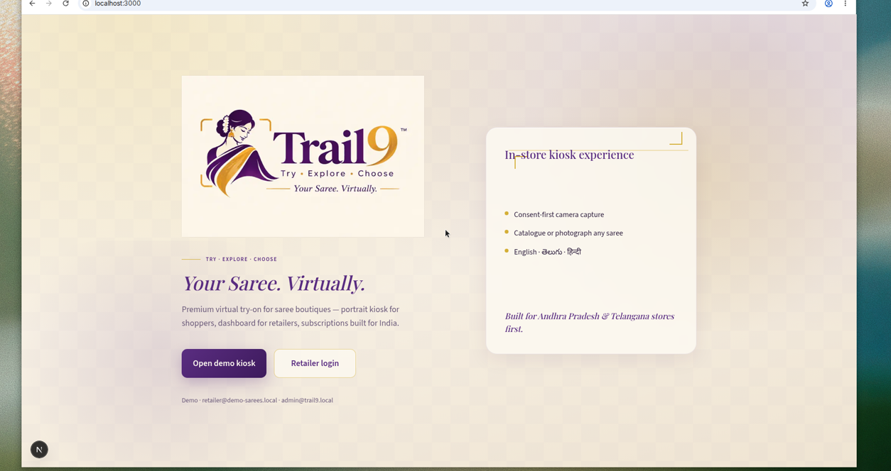
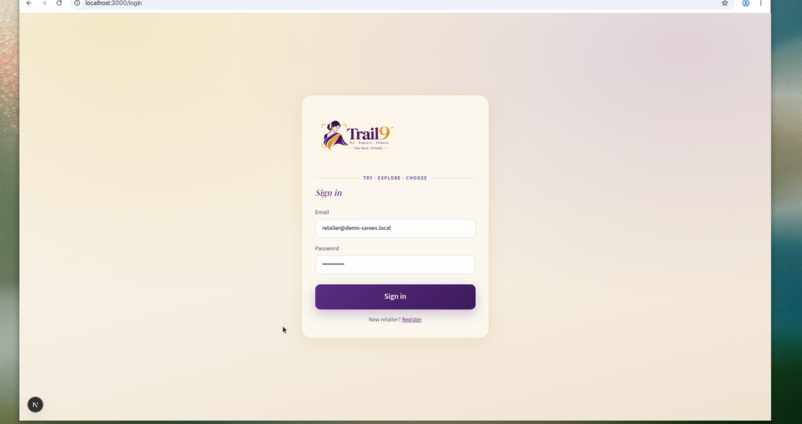
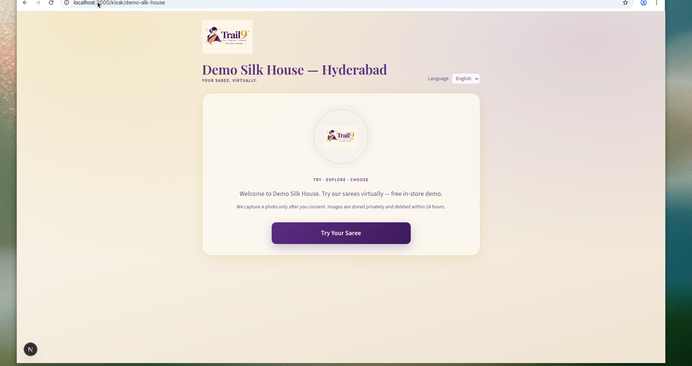
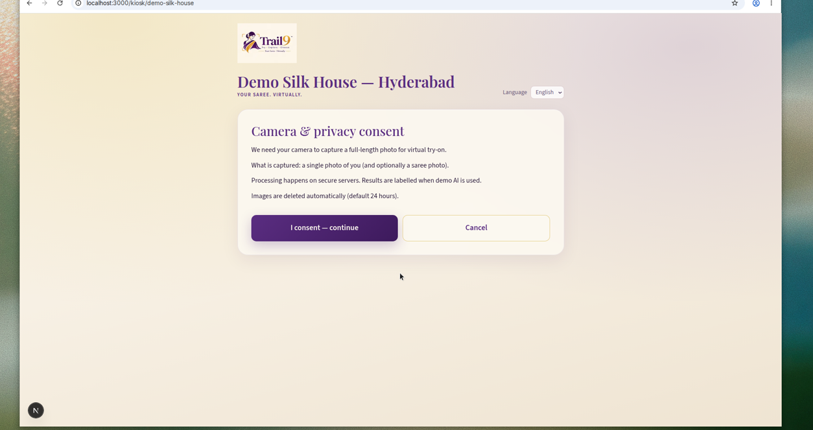
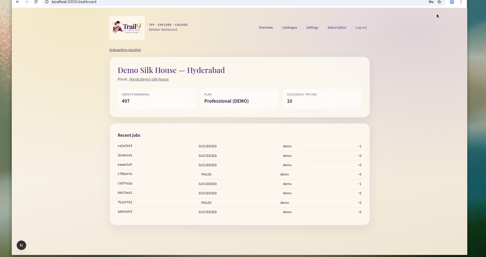

# Trail9 — Your Saree. Virtually.

Multi-tenant AI virtual saree try-on for Indian textile retailers.

**Try · Explore · Choose**

- **Kiosk** — consent → camera → saree select → real try-on job → labelled demo result  
- **Retailer dashboard** — catalogue, usage, branding, subscription  
- **Super-admin** — retailers, plans, AI providers, metrics  

Local demo runs with **DemoTryOnProvider** (no paid API keys). Results are clearly labelled `DEMO — not real AI try-on`.

<p align="center">
  
</p>

## Screenshots

| Landing | Login |
| --- | --- |
|  |  |

| Kiosk welcome | Consent |
| --- | --- |
|  |  |

| Retailer dashboard |
| --- |
|  |

## Stack

- Next.js 15 (App Router) + Prisma + PostgreSQL  
- FastAPI AI worker (`SelfHostedTryOnProvider` contract)  
- Docker Compose for Postgres / Redis / services  
- Razorpay Subscriptions (test) behind a payment abstraction  

## Quick start (local)

```bash
# 1. Copy env
cp .env.example .env

# 2. Start Postgres (Docker) — or use a local Postgres matching DATABASE_URL
docker compose up -d postgres redis

# 3. Install & migrate
cd apps/web
npm install
npx prisma migrate deploy
UPLOAD_DIR=../../uploads npm run db:seed

# 4. Run web + AI worker
npm run dev          # http://localhost:3000
# from repo root:
npm run ai:dev       # http://localhost:8000
```

### Demo accounts (seeded)

| Role | Email | Password |
|------|-------|----------|
| Super-admin | `admin@trail9.local` | `Admin123!` |
| Retailer | `retailer@demo-sarees.local` | `Retailer123!` |

Kiosk: [http://localhost:3000/kiosk/demo-silk-house](http://localhost:3000/kiosk/demo-silk-house)

## Environment

See `.env.example`. Important:

- `TRYON_PROVIDER=demo|external|selfhosted`
- Leave `RAZORPAY_*` empty for explicit **missing_credentials** billing mode (never fakes payment success)
- Never put secrets in `NEXT_PUBLIC_*`

## Docker

```bash
cp .env.example .env
docker compose up --build
```

## Tests

```bash
npm run test --workspace=apps/web
npm run ai:test
npm run lint --workspace=apps/web
npm run typecheck --workspace=apps/web
```

## Docs

- [`docs/DEPLOYMENT.md`](docs/DEPLOYMENT.md) — production setup  
- [`docs/AI_PROVIDER.md`](docs/AI_PROVIDER.md) — honest AI integration status  
- [`docs/phase2-final-report.md`](docs/phase2-final-report.md) — pilot readiness  

## Brand

Deep plum `#42105C` · electric teal `#00BFCB` · gold `#D99A22` · ivory `#FFF9EF` · logo in `apps/web/public/brand/`
